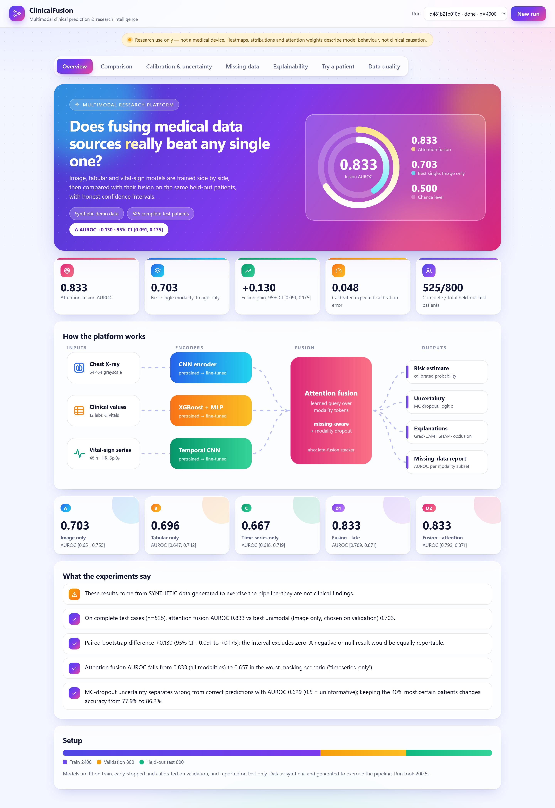
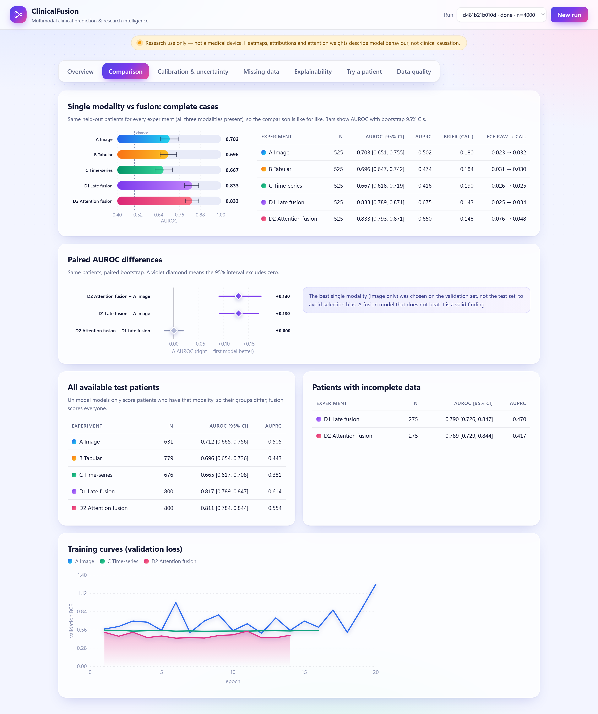
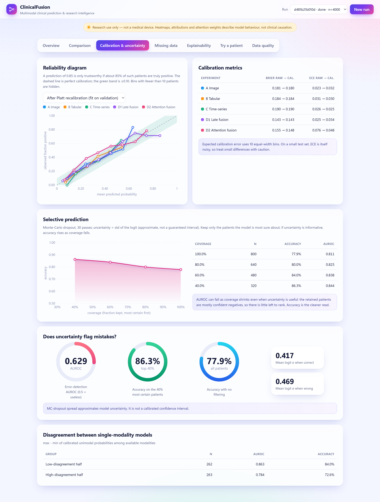
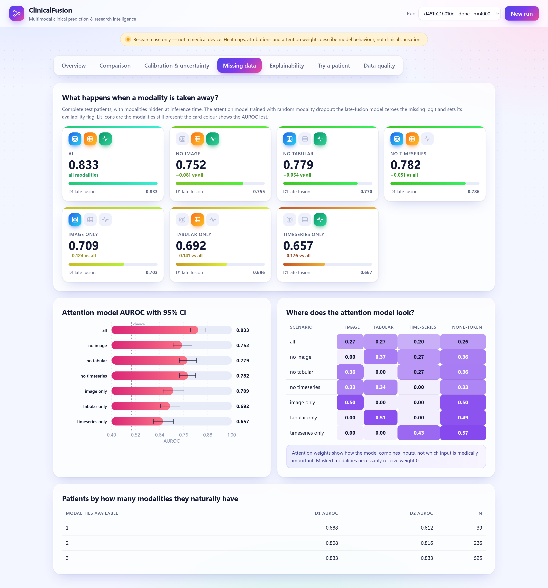
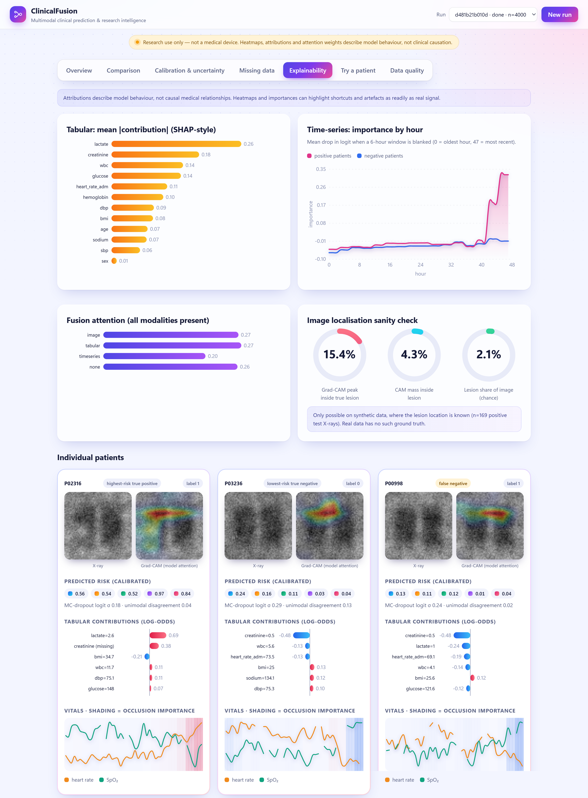

# ClinicalFusion

**Multimodal clinical prediction & research intelligence platform.**
Combines chest X-ray images, tabular clinical data and vital-sign time-series, and measures — honestly, with
confidence intervals — whether fusing them beats using any single source.

> **Research software. Not a medical device.** Do not use it for patient care. Heatmaps, attributions and
> attention weights describe model behaviour, not medical causation. The bundled cohort is **synthetic**;
> results on it are not clinical findings.



<details>
<summary>More screenshots (synthetic demo data)</summary>

| | |
|---|---|
|  |  |
|  |  |

</details>

## What it does

Four experiments are trained on one cohort and evaluated on the same held-out test patients:

| Exp | Data used | Model |
|---|---|---|
| **A** | X-ray only | CNN (PyTorch) |
| **B** | Clinical numbers only | XGBoost (or CatBoost) |
| **C** | Vital-sign time-series only | Temporal CNN (or LSTM) |
| **D1** | All three | Late fusion: logistic stacker over A/B/C logits + availability flags |
| **D2** | All three | Feature-level **attention fusion**, missing-modality aware |

Around that core:

* **Data validation** — schema, plausible ranges, duplicate IDs, label checks, per-modality availability,
  completeness patterns, cross-source patient-ID overlap (`match_patient_ids`).
* **Honest comparison** — complete-case comparison on identical patients, bootstrap 95% CIs, paired AUROC
  differences, best single modality picked on *validation* (not test). Null/negative results are reported the same way.
* **Calibration** — reliability curves, Brier score, expected calibration error, Platt recalibration fit on validation only.
* **Uncertainty** — Monte-Carlo dropout, selective prediction (AUROC vs coverage), does-uncertainty-flag-errors check,
  and disagreement between single-modality models.
* **Missing data** — modality dropout in training; at test time, every modality can be masked; reports how AUROC and
  attention shift, and results by number of naturally available modalities.
* **Explainability** — Grad-CAM (image), SHAP-style tree contributions (tabular), occlusion over hours (time-series),
  fusion attention; plus a ground-truth localisation check on synthetic lesions.
* **Serving** — FastAPI + PostgreSQL/SQLite, single-patient inference with *any subset* of modalities, MLflow tracking,
  Docker Compose, and a dependency-free dashboard.

## Quick start

```bash
python -m venv .venv && source .venv/bin/activate        # Windows: .venv\Scripts\activate
pip install torch --index-url https://download.pytorch.org/whl/cpu
pip install -e ".[dev]"                                   # add ,catboost,mlflow,postgres as needed

clinicalfusion run --preset fast --out runs/demo          # ~1-2 min on CPU; prints findings, writes results.json
clinicalfusion run --preset standard --out runs/full      # 4,000 patients, ~3 min on a laptop CPU
clinicalfusion serve                                      # dashboard + API at http://127.0.0.1:8000
pytest                                                    # 31 tests, ~20 s
```

With Docker (API + PostgreSQL + MLflow):

```bash
docker compose up --build        # dashboard :8000, MLflow :5000   (set CF_API_KEY and POSTGRES_PASSWORD first)
```

## Project layout

```
src/clinicalfusion/
  config.py                   Config + presets
  data/        schema, synthetic cohort, validation, preprocessing/splits, on-disk loader (real-data bridge)
  models/      encoders (CNN, TCN, LSTM, MLP), fusion (attention + stacker), tabular GBM, training loop, MC dropout
  evaluation/  AUROC/AUPRC/Brier/ECE, bootstrap CIs, paired differences, selective prediction, Platt calibration
  explain/     Grad-CAM, time-series occlusion, image rendering
  experiments/ runner.py - executes A-D and assembles the full report
  predictor.py trained-system container (batch + single-patient inference, save/load)
  api/         FastAPI app, SQLAlchemy models, static dashboard
  tracking.py  optional MLflow logging         cli.py  `clinicalfusion run | serve | export-synthetic`
docs/REAL_DATA.md             how to move from synthetic to MIMIC-IV / MIMIC-CXR / PhysioNet
tests/                        unit + end-to-end + API tests
```

## API

| Method | Path | Purpose |
|---|---|---|
| POST | `/api/runs` | start a run (`preset`, `n_patients`, `seed`, `ts_arch`, …); one at a time |
| GET | `/api/runs`, `/api/runs/{id}` | list / status + progress |
| GET | `/api/runs/{id}/results` | full report JSON |
| GET | `/api/runs/{id}/predictions` | per-patient test predictions (`experiment`, `patient_id`, paging) |
| POST | `/api/predict` | single patient, any subset of `tabular` / `timeseries` / `image` |
| DELETE | `/api/runs/{id}` | remove a run and its artifacts |
| GET | `/docs` | OpenAPI UI |

Environment: `DATABASE_URL` (default SQLite; use `postgresql+psycopg2://…`), `CF_API_KEY` (require `X-API-Key`),
`CF_ARTIFACT_DIR`, `CF_DATA_DIR` (real cohort), `CF_MLFLOW=1` + `MLFLOW_TRACKING_URI`.

## Design decisions worth knowing

* **Leakage control.** Patient-level stratified split; normalisers fit on train only; early stopping and calibration use
  validation only; the late-fusion stacker is fit on validation logits; test is touched once for reporting.
* **Fair comparison.** Unimodal models only see patients who have that modality, so headline numbers use the
  complete-case test subset where every experiment scores the same people. Available-case tables are shown too.
* **Missing modalities are first-class.** The attention model always has a learned "none" token, so any subset of
  modalities (even none) gives a valid output; availability masks are explicit, never imputed with fake pixels.
* **Synthetic data design.** Each modality is generated from its own independent latent factor, and the outcome depends
  on all three, so fusion *can* help by construction. Real data will not be this clean — see `docs/REAL_DATA.md`.
* **Security.** No user management. Use `CF_API_KEY`, keep the service private, never send real patient data to a
  public deployment, and respect each dataset's data-use agreement. Model bundles are pickled: load only your own.

## Roadmap ideas

Vision-Transformer image backbone · cross-modal attention with time-aligned tokens · pretrained chest-X-ray encoders ·
group-aware (multi-stay) splitting · conformal prediction intervals · subgroup/fairness reports · a React/Next.js
front-end on top of the existing JSON API.
